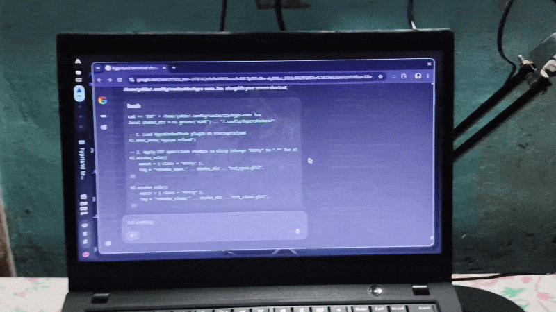

# HYPR-CRT-EFFECTS
CRT window open/close shaders and DPMS screen wake/off animations for Hyprland.

# Hyprland CRT Window & DPMS Effects

CRT collapse/expand shaders for window open/close and DPMS screen power-off/wake animations in Hyprland[cite: 1, 2, 3, 4, 5].

> **Note on My Setup (Caelestia Shell):** I use **Caelestia Shell**, so my config uses Lua (`hypr-user.lua`) and `hl.*` helpers rather than a plain `hyprland.conf` / `hyprland.lua` file or standard `exec-once` syntax. Some file paths, config hooks, and `hyprctl eval` / `hyprctl dispatch` calls in this repo are written for my setup and may differ on a standard non-Caelestia Hyprland setup.

---

## Preview

 

---

## Requirements

- **Hyprland** (with `hyprpm` plugin manager installed)
- **HyprWindowShade** (`ManofJELLO/HyprWindowShade`) — **required** for `+shader_open:` and `+shader_close:` per-window shader tags
- **Standard CLI tools** for the screen DPMS script: `bash`, `sed`, `grep`, and `hyprctl`

---

## Installation

### Step 1: Install HyprWindowShade
Install and enable the plugin via `hyprpm`:

```bash
hyprpm update
hyprpm add [https://github.com/ManofJELLO/HyprWindowShade](https://github.com/ManofJELLO/HyprWindowShade)
hyprpm enable HyprWindowShade
hyprpm reload -n

(Whenever Hyprland updates, run hyprpm update so the plugin stays compatible with your Hyprland build.)
```

### Step 2: Window Open/Close CRT Effects
https://github.com/user-attachments/assets/4b0f7387-29f0-4d21-bbea-1546f8466906
1. Copy `crt_open.glsl` and `crt_close.glsl` to `~/.config/hypr/shaders/`.
2. Copy or merge `hypr-user.lua` into `~/.config/hypr/hypr-user.lua` (using `os.getenv("HOME")` or `$HOME` instead of hardcoded user paths).
3. If you do not use a separate wake listener script, remove or comment out any `hl.exec_cmd(...crt-wake-listener.sh...)` line unless you have that script in place.

### Step 3: Screen Power Off/Wake CRT Effect (Separate Module)
[Watch CRT Apps Toggle Demo](preview/preview-screen-crt-toggle.mp4)
1. Copy `screen_crt.glsl` to `~/.config/hypr/shaders/`.
2. Copy `crt-dpms.sh` to `~/.config/hypr/scripts/` (using `"$HOME"` instead of a hardcoded home folder path).
3. Make the script executable:

```bash
chmod +x ~/.config/hypr/scripts/crt-dpms.sh
```

---

## Fixes for Normal (Non-Caelestia Shell) Hyprland Users

If you are **not** using Caelestia Shell, adjust the Caelestia-specific parts as follows:

1. **Config file instead of `hypr-user.lua`:** Put your window rules, keybinds, and startup commands in `~/.config/hypr/hyprland.conf` (or a sourced file) instead of `hypr-user.lua`.
2. **Startup & keybinds instead of `hl.*`:** Replace `hl.exec_cmd(...)` with `exec-once = ...`, and replace `hl.bind(..., hl.dsp.exec_cmd(...))` with a standard `bind` in `hyprland.conf`.
3. **Paths:** Replace `os.getenv("HOME")` with `$HOME` in shell scripts or explicit paths in `hyprland.conf`.
4. **`hyprctl` calls inside `crt-dpms.sh`:** `crt-dpms.sh` uses `hyprctl eval 'hl.config(...)'` and `hyprctl dispatch 'hl.dsp.dpms("off")'`, which target Caelestia's Lua Hyprland wrapper. On standard Hyprland without `hl.*` Lua helpers, replace those calls with standard Hyprland commands:
   - Clear shader: `hyprctl keyword decoration:screen_shader ""`
   - Set shader: `hyprctl keyword decoration:screen_shader "$TMP_SHADER"`
   - Turn display off: `hyprctl dispatch dpms off`

---

## ⚠️ Warning: Black Screen on Wake

**Do not panic or hard-reboot if your screen wakes up black.**

When waking a monitor from DPMS (`dpmsStatus: 0` to `1`), the display panel/backlight can wake a split second later than the shader animation, or a shader state can linger and make the screen look black even though your session is alive.

- **Wait a moment** after moving your mouse or pressing a key so the panel backlight and wake animation finish settling.
- **Reset the shader immediately** if it ever stays stuck on a black screen:
  - On Caelestia / Lua setup: `hyprctl eval 'hl.config({ decoration = { screen_shader = "" } })'`
  - On standard Hyprland setup: `hyprctl keyword decoration:screen_shader ""`
- **TTY fallback:** If your display stays frozen or black, switch to a virtual terminal with `Ctrl + Alt + F3`, log in, clear the shader or kill `crt-dpms.sh`, and switch back (`Ctrl + Alt + F1` or `F2`).
